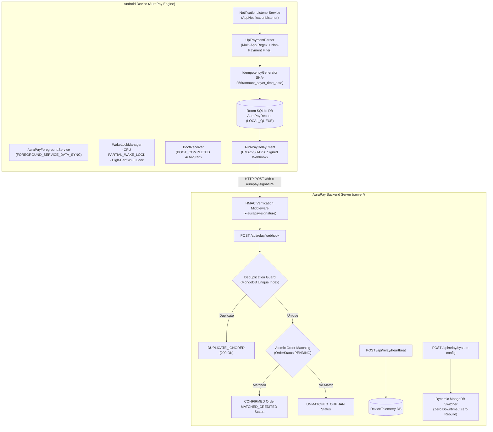

# AuraPay Relay Engine — Full Implementation & Architecture Specification

Production-grade Android Payment Notification Relay System and Automated Ledger Reconciliation Backend designed for high-volume UPI merchant operations.

---

## 1. System Overview & Architecture



---

## 2. Real-Time UPI Payment Capture

### Supported Apps & Patterns
1. **Google Pay for Business** (`com.google.nbu.paisa.merchant`):
   ```regex
   /₹([0-9,]+(?:\.[0-9]{1,2})?)\s+received\s+from\s+(.+?)\s+at\s+([0-9:]+(?:\s*[ap]m)?)/i
   ```
   **Capture Sample**:
   > `"₹1.01 received from AARAV MISHRA at 12:05 am"`
   - `amount`: `1.01`
   - `payerName`: `"AARAV MISHRA"`
   - `notificationTime`: `"12:05 am"`

2. **PhonePe Business** (`com.phonepe.app.business`):
   ```regex
   /received\s+₹([0-9,]+(?:\.[0-9]{1,2})?)\s+from\s+(.+?)(?:\s+via\s+PhonePe)?/i
   ```
   **Sample**: `"Received ₹500.00 from RAMESH K via PhonePe"`

3. **Paytm for Business** (`net.one97.paytm`):
   ```regex
   /payment\s+of\s+₹([0-9,]+(?:\.[0-9]{1,2})?)\s+received\s+from\s+(.+)/i
   ```
   **Sample**: `"Payment of ₹250.50 received from SNEHA P"`

4. **BharatPe** (`com.bharatpe.app`) & **Google Pay Personal** (`com.google.android.apps.nbu.paisa.user`)

5. **Non-Payment Rejection**:
   Automatically discards:
   - OTPs (`/otp|one time password|verification code/i`)
   - Debited / Spent alerts (`/debited|spent|sent to|withdrawn|paid to/i`)
   - Balance enquiries (`/balance enquiry|available balance/i`)
   - Promotions & Cashback (`/cashback|discount|offer|loan/i`)

---

## 3. Native Android Unkillable Architecture

- **`NotificationListenerService`**: Direct OS-level interception.
- **Persistent Foreground Service (`dataSync`)**: [AuraPayForegroundService.kt](file:///c:/Users/Lenovo/Desktop/android-notification-forwarder-master/app/src/main/java/com/karuhundeveloper/notification/aurapay/service/AuraPayForegroundService.kt) runs with `FOREGROUND_SERVICE_DATA_SYNC` and shows live forwarded counts and today's total amount in the system tray.
- **Hardware WakeLocks**: [WakeLockManager.kt](file:///c:/Users/Lenovo/Desktop/android-notification-forwarder-master/app/src/main/java/com/karuhundeveloper/notification/aurapay/wakelock/WakeLockManager.kt) maintains:
  - `PowerManager.PARTIAL_WAKE_LOCK`: Keeps CPU processing while screen is locked.
  - `WifiManager.WIFI_MODE_FULL_HIGH_PERF`: Prevents Wi-Fi radio sleep for sub-second webhook latency.
- **Boot Auto-Restart**: [BootReceiver.kt](file:///c:/Users/Lenovo/Desktop/android-notification-forwarder-master/app/src/main/java/com/karuhundeveloper/notification/aurapay/service/BootReceiver.kt) catches `BOOT_COMPLETED`, `QUICKBOOT_POWERON`, and `REBOOT` to restart the service and rebind listener.
- **Battery Optimization**: UI triggers `REQUEST_IGNORE_BATTERY_OPTIMIZATIONS` intent to bypass Doze mode.

---

## 4. Security, Deduplication & Reliability

### Deterministic SHA-256 Idempotency Key
Formula:
$$\text{idempotencyKey} = \text{SHA256}(\text{amount} \parallel \text{"\_"} \parallel \text{normalizedPayer} \parallel \text{"\_"} \parallel \text{normalizedTime} \parallel \text{"\_"} \parallel \text{YYYY-MM-DD})$$
Guarantees deduplication across retries and repeated notification deliveries via MongoDB unique index.

### HMAC-SHA256 Webhook Authentication
Requests to `/api/relay/webhook` are signed:
```
x-aurapay-signature: <hex-encoded HMAC-SHA256 of JSON body using shared secret>
```

### Persistent Offline Queue
Unsent payments are persisted in Room database `aurapay_records` with state `LOCAL_QUEUE`. Background worker flushes pending items every 15 seconds with exponential backoff.

---

## 5. Mobile Control Center & Dashboard (Compose UI)

1. **Telemetry Screen**:
   - Live KPI cards: Today's Amount, All-Time Amount, Forwarded Count, Matched Orders, Orphan Count.
   - Device Health strip: Battery % with charging icon, Network type, CPU WakeLock, Wi-Fi Lock, Listener status, Battery Optimization status.
   - Real-time notification feed with color-coded status badges (`MATCHED_CREDITED`, `UNMATCHED_ORPHAN`, `DUPLICATE_IGNORED`, `LOCAL_QUEUE`).

2. **Ledger & Orphan Claim Screen**:
   - Filter Tabs: `All`, `Credited`, `Orphans`, `Queue`.
   - Manual Assignment Modal: Assigns orphan payments to Order ID / Customer ID via `/api/relay/orphans/claim`.

3. **Dynamic Diagnostics & Config Screen (Zero-Rebuild)**:
   - Configurable: Server Base URL, Webhook Secret, Device ID, Target Packages.
   - Dynamic Database Switcher: Change `mongoUri` at runtime without touching code or rebuilding APKs.
   - Merchant UPI VPA & Merchant Name fields.
   - Diagnostic tools:
     - "Simulate GPay Notification" (fires `"₹1.01 received from AARAV MISHRA at 12:05 am"`)
     - "Test Database Connection" (live ping and collection count)
     - "Manual Queue Flush"

---

## 6. Backend Server (`server/`)

### Setup & Run
```bash
cd server
npm install
npm test
npm start
```
Default server runs on port 5000:
- Webhook Ingestion: `POST /api/relay/webhook`
- Device Telemetry / Heartbeat: `POST /api/relay/heartbeat` & `GET /api/relay/telemetry`
- Dynamic Config: `GET /api/relay/system-config` & `POST /api/relay/system-config`
- Orphan Claim: `GET /api/relay/orphans` & `POST /api/relay/orphans/claim`
- Database Diagnostics: `GET/POST /api/relay/test-db`
- Payment Simulator: `POST /api/relay/simulate`
